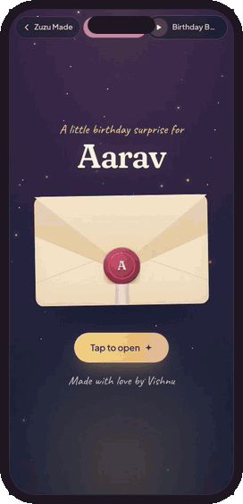
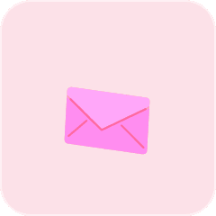
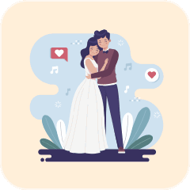
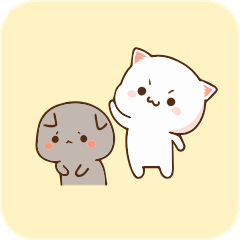
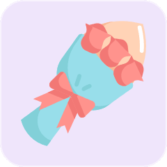
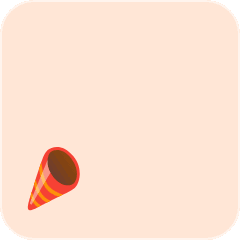
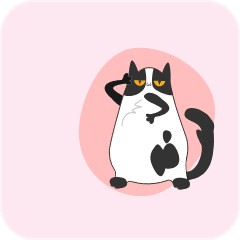

<a href="https://zuzumade.com">
  <picture>
    <source media="(prefers-color-scheme: dark)" srcset="assets/banner-dark.svg" />
    
  </picture>
</a>

  <picture>
    <source media="(prefers-color-scheme: dark)" srcset="assets/tagline-dark.svg" />
    
  </picture>

  
  
  
   
  
  
  
  

<h3 align="center">Your photos, music and words, turned into a little website made for one person 💗</h3>

<i>Aapki photos, music aur dil ki baatein: ek chhoti si website, sirf unke liye.</i>

 

<h2 align="center">✨ See it in action · <i>Dekho kaise khulta hai</i></h2>

  

  A real birthday surprise opening on a phone. <a href="https://zuzumade.com/demo/birthday"><b>Open the demo →</b></a> 
  <i>Ek asli birthday surprise, phone par khulta hua.</i>

 

<h2 align="center">🎁 One for every feeling · <i>Har jazbaat ke liye ek</i></h2>

<table align="center">
  <tr>
    <td align="center" valign="top" width="33%">
       
      <b>Birthday</b> 
      Candles they blow out, balloons full of reasons 
      <i>Candles bujhao, reasons wale balloons</i>
    </td>
    <td align="center" valign="top" width="33%">
       
      <b>Love</b> 
      Your memories sealed in wax, opened slowly 
      <i>Wax seal me band yaadein, dheere se khulti</i>
    </td>
    <td align="center" valign="top" width="33%">
       
      <b>Anniversary</b> 
      Your years as a golden timeline and album 
      <i>Aapke saal, sunehri timeline me</i>
    </td>
  </tr>
  <tr>
    <td align="center" valign="top">
       
      <b>Best friend</b> 
      Inside jokes, a photo-booth strip, a real note 
      <i>Inside jokes, photo-booth aur ek sachcha note</i>
    </td>
    <td align="center" valign="top">
       
      <b>Sorry</b> 
      Every line rebuilds a little bridge back 
      <i>Har line wapas jaane ka chhota pul</i>
    </td>
    <td align="center" valign="top">
       
      <b>Wedding invites</b> 
      Your story, venue and RSVP in one link 
      <i>Kahani, venue aur RSVP, ek link me</i>
    </td>
  </tr>
  <tr>
    <td align="center" valign="top">
       
      <b>Surprise</b> 
      Clues, a golden key and a box only they open 
      <i>Clues, sunehri chaabi aur ek band box</i>
    </td>
    <td align="center" valign="top">
       
      <b>Festivals</b> 
      Diwali, Bhai Dooj, Christmas, New Year 
      <i>Tyohaar, apno ke saath</i>
    </td>
    <td align="center" valign="top">
       
      <b>Memory book &amp; puzzle</b> 
      A book that really turns, a photo puzzle with a note 
      <i>Panne palatne wali book, puzzle me chhupa message</i>
    </td>
  </tr>
</table>

 

<h2 align="center">🪄 How it works · <i>Kaise kaam karta hai</i></h2>

<table align="center">
  <tr>
    <td align="center" valign="top" width="33%">
       
      <b>Pick a feeling</b> 
      Choose an occasion and a template you love 
      <i>Occasion aur pasand ka template chuno</i>
    </td>
    <td align="center" valign="top" width="33%">
       
      <b>Make it theirs</b> 
      Add names, photos, a song and your words 
      <i>Naam, photos, gaana aur apne shabd jodo</i>
    </td>
    <td align="center" valign="top" width="33%">
       
      <b>Send one link</b> 
      Share on WhatsApp or anywhere, opens in any browser 
      <i>WhatsApp par bhejo, kisi bhi phone par khule</i>
    </td>
  </tr>
</table>

 

<b>🇬🇧 About ZuzuMade (English)</b>

 

**ZuzuMade** turns your photos, music and words into a little website made for one person.
They open it on their phone and it plays like a gift: a cake they blow out, a letter that unseals,
a puzzle that reveals your note, a sky full of fireworks.

- 💌 **No app needed.** It opens in any phone or desktop browser.
- 👀 **See it before you pay.** Build the whole surprise and preview every bit for free.
- 🔒 **One private link.** Only people with the link can open it.
- 🗣️ **English or Hinglish.** The site speaks both.

**Make yours at [zuzumade.com](https://zuzumade.com)** ✨

<b>🇮🇳 ZuzuMade ke baare me (Hinglish)</b>

 

**ZuzuMade** aapki photos, music aur dil ki baaton ko ek chhoti si website bana deta hai, sirf ek insaan ke liye.
Woh use apne phone par kholte hain aur woh ek gift ki tarah khulti hai: cake ki candles jo woh bujhaate hain,
seal tod kar khulne wala letter, ek puzzle jo aapka message dikhata hai, aur aatishbaazi se bhara aasmaan.

- 💌 **Koi app nahi chahiye.** Kisi bhi phone ya laptop ke browser me khul jaata hai.
- 👀 **Pay karne se pehle dekho.** Pura surprise banao aur free me har cheez preview karo.
- 🔒 **Ek private link.** Sirf jinke paas link hai, wahi khol sakte hain.
- 🗣️ **English ya Hinglish.** Site dono bolti hai.

**Apna surprise banao [zuzumade.com](https://zuzumade.com) par** ✨

 

<h2 align="center">📝 Fresh from the blog · <i>Blog se taaza</i></h2>

Gift ideas, guides and little ways to make someone feel special. Updates on its own from <a href="https://zuzumade.com/blog">zuzumade.com/blog</a>.

<!-- BLOG:START -->
<table>
<tr><td align="center" valign="top" width="33%"> <a href="https://zuzumade.com/blog/romantic-birthday-surprise-ideas-for-wife-girlfriend"><b>15 Romantic Birthday Surprise Ideas for Wife &amp; Girlfriend ❤️🎂</b></a> Love · 19 Nov 2026</td><td align="center" valign="top" width="33%"> <a href="https://zuzumade.com/blog/new-year-surprise-ideas-for-mom-family"><b>New Year Surprise Ideas for Mom &amp; Family: 15 Ways to Welcome 2027 🎆</b></a> Festivals · 19 Nov 2026</td><td align="center" valign="top" width="33%"> <a href="https://zuzumade.com/blog/christmas-surprise-ideas-for-girlfriend-wife"><b>Christmas Surprise Ideas for Girlfriend &amp; Wife: 15 Ideas 🎄❤️</b></a> Love · 19 Nov 2026</td></tr>
<tr><td align="center" valign="top" width="33%"> <a href="https://zuzumade.com/blog/birthday-surprise-ideas-for-sister"><b>15 Birthday Surprise Ideas for Sister That She Will Never Forget 🎂</b></a> Birthday · 19 Nov 2026</td><td align="center" valign="top" width="33%"> <a href="https://zuzumade.com/blog/happy-new-year-2027-wishes"><b>Happy New Year 2027 Wishes: 54 Messages for Love, Family &amp; Work 🎆</b></a> Festivals · 18 Nov 2026</td><td align="center" valign="top" width="33%"> <a href="https://zuzumade.com/blog/princess-day-2026-wishes"><b>Princess Day 2026: 52 Wishes for Girlfriend, Daughter &amp; Sister 👑❤️</b></a> Festivals · 18 Nov 2026</td></tr>
</table>
<!-- BLOG:END -->

<a href="https://zuzumade.com/blog"><b>Read all posts →</b></a>

 

<h2 align="center">💬 Say hi · <i>Humse baat karo</i></h2>

  🌐 <a href="https://zuzumade.com">zuzumade.com</a> &nbsp;·&nbsp;
  📸 <a href="https://www.instagram.com/zuzu__made/">Instagram</a> &nbsp;·&nbsp;
  ▶️ <a href="https://www.youtube.com/@zuzu_made">YouTube</a> &nbsp;·&nbsp;
  📌 <a href="https://in.pinterest.com/zuzu_made/">Pinterest</a> &nbsp;·&nbsp;
  👍 <a href="https://www.facebook.com/zuzumadeco/">Facebook</a> &nbsp;·&nbsp;
  💚 <a href="https://whatsapp.com/channel/0029Vb9H0iMJP211LPyBRc0f">WhatsApp channel</a> 
  ✉️ <a href="mailto:zuzumade.support@gmail.com">zuzumade.support@gmail.com</a>

  

<picture>
  <source media="(prefers-color-scheme: dark)" srcset="assets/wave-dark.svg" />
  
</picture>

  <b>Made with 💗 in India</b> · <a href="https://zuzumade.com">zuzumade.com</a>

